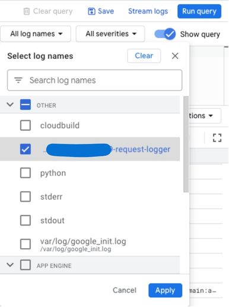
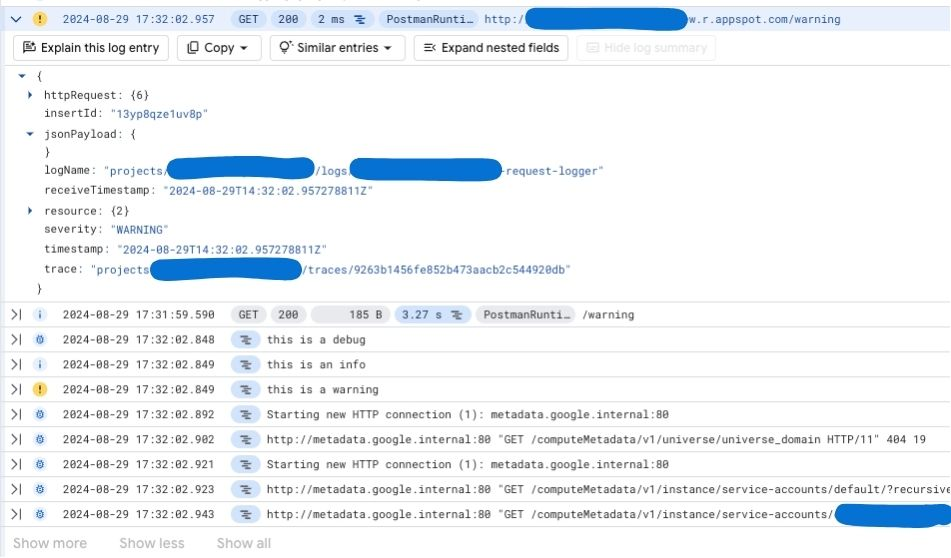
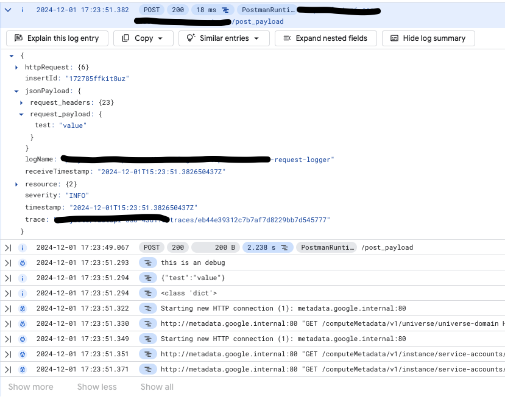

# fastapi-gae-logging
Custom Cloud Logging handler for FastAPI (or any Starlette based) applications deployed in Google App Engine to ease out logs analysis and monitoring through Google Cloud Log Explorer.

## What problem does this package solve? Why do we need this?
When deploying FastAPI applications on Google App Engine, I encountered several challenges with logging and observability even when using the official package for this purpose, `google-cloud-logging`.

- **Scattered Logs**: Logs generated during a single request lifecycle were scattered across different log entries, making it difficult to trace the entire flow of a request, especially when troubleshooting issues.

- **Log Severity Mismatch**: The severity level of logs was not properly propagated throughout the request lifecycle. This meant that if an error occurred at any point in the request, the earlier logs did not reflect the severity of the final outcome, making it harder to identify problematic requests.

- **Payload Logging Issues**: Capturing and logging request payloads was cumbersome, requiring extra logging in the handlers and extra deployments. This led to incomplete logs, making it harder to reproduce issues or analyze request content.

- **Inconsistent Log Structures**: The default logging setup lacked a consistent structure, which made it challenging to filter, search, and analyze logs in the Google Cloud Log Explorer.

## So what does it do? 
The `fastapi-gae-logging` module addresses these problems by:

- **Grouping Logs by Request**: All logs generated during a request's lifecycle are grouped together, allowing for a complete view of the request flow in the Google Cloud Log Explorer. This makes it much easier to trace and troubleshoot issues.

- **Log Level Propagation**: The maximum log level observed during a request's lifecycle is propagated, ensuring that logs associated with a failed request reflect the appropriate severity. This improves the accuracy and utility of log searches based on severity.

- **Structured Payload Logging**: Request payloads are captured and logged in a structured format, even for non-dictionary JSON payloads. This ensures that all relevant request data is available for analysis, improving the ability to diagnose issues.


## Install
`pip install fastapi-gae-logging`

## Features:

- **Request Logs Grouping**: Groups logs from the same request lifecycle to simplify log analysis using Google Cloud Log Explorer. The logger name for grouping can be customized and defaults to the Google Cloud Project ID with '-request-logger' as a suffix.
- **Request Maximum Log Level Propagation**: Propagates the maximum log level throughout the request lifecycle, making it easier to search logs based on the severity of an issue.
- **Trace header support**: Reads the W3C `traceparent` header first and falls back to the legacy `X-Cloud-Trace-Context` header. Headers are validated, and a malformed `traceparent` falls back to the legacy header instead of losing the trace. The legacy decimal span ID is converted to the 16-character hex form Cloud Logging expects.
- **Optional trace isolation**: Defaults to False. Gives every request its own trace ID, so requests that share an upstream trace ID no longer group together. The upstream trace and span are kept as labels. See [Grouping by trace and `isolate_trace`](#grouping-by-trace-and-isolate_trace).
- **Thread pool support**: `inject_gae_request_context` carries the request context into raw `ThreadPoolExecutor` threads. See [Thread pools](#thread-pools).
- **Optional request headers logging**: Defaults to False. Headers dict lands into field `request_headers` in the `jsonPayload` of parent log.
- **Optional request payload logging**: Defaults to False. Incoming payload parsed lands into field `request_payload` in the `jsonPayload` of parent log. Parsing is based on content type with capability to override. Currently embedded parsers for:
    - `application/json`
    - `application/x-www-form-urlencoded`
    - `multipart/form-data`
    - `text/plain`
- **Optional add-on log filters**:
    - `GaeLogSizeLimitFilter` filter to drop log records if they exceed the maximum allowed size by google cloud logging.
    - `GaeUrlib3FullPoolFilter` filter to drop noisy 'Connection pool is full' warning logs
    from Google Cloud and App Engine internal libraries.

## API

- Initialization

```python
FastAPIGAELoggingHandler(
    app: Starlette,
    client: google.cloud.logging.Client,
    request_logger_name: Optional[str] = None,
    log_payload: bool = False,
    log_headers: bool = False,
    builtin_payload_parsers: Optional[List[PayloadParser.Defaults]] = None,
    custom_payload_parsers: Optional[Dict[str, Callable[[Request], Awaitable[Any]]]] = None,
    isolate_trace: bool = False,
    *args, **kwargs
)
```

- Parameters
    - **app** (FastAPI | Starlette): The FastAPI or Starlette application instance.
    - **client** (google.cloud.logging.Client): The Google Cloud Logging Client instance. This is required to initialize the handler and retrieve the project ID.
    - **request_logger_name** (Optional[str]): The name of the Cloud Logging logger to use for request logs. Defaults to the Google Cloud Project ID with the suffix '-request-logger'.
    - **log_payload** (bool): Whether to log the request payload. If True, the payload for POST, PUT, PATCH, and DELETE requests will be captured and logged. Defaults to False.
    - **log_headers** (bool): Whether to log the request headers. Defaults to False.
    - **builtin_payload_parsers** (Optional[List[PayloadParser.Defaults]]): A list of built-in parser enums to enable (e.g., [PayloadParser.Defaults.JSON, PayloadParser.Defaults.FORM_URLENCODED]).
    - **custom_payload_parsers** (Optional[Dict[str, Callable[[Request], Awaitable[Any]]]]): A dictionary mapping MIME types (e.g., 'application/custom+xml') to async parser coroutines. These coroutines must accept a Request object and return a serializable result to log. If provided, these will override default parsers for the specified content types.
    - **isolate_trace** (bool): Whether to give every request its own trace ID instead of using the incoming one. The incoming trace and span are preserved as the labels `upstream_trace_id` and `upstream_span_id`. Defaults to False. See [Grouping by trace and `isolate_trace`](#grouping-by-trace-and-isolate_trace).
    - ***args**: Additional arguments to pass to the superclass constructor. Any argument you would pass to CloudLoggingHandler. Since 0.3.0, `isolate_trace` sits before `*args`, so pass `CloudLoggingHandler` arguments by keyword.
    - ****kwargs**: Additional keyword arguments to pass to the superclass constructor. Any keyword argument you would pass to  CloudLoggingHandler.

## Grouping by trace and `isolate_trace`

Log Explorer groups entries by their `trace` field. By default this library uses the trace ID of the incoming request (`traceparent`, then `X-Cloud-Trace-Context`), so app logs group under the request log.

A trace ID identifies a distributed transaction, not a single request. When an upstream caller reuses one trace ID for several calls to your service (APM agents typically use one trace ID per transaction), App Engine passes that trace ID on and all those requests share a trace. Log Explorer then shows the logs of every one of them under each request log.

Set `isolate_trace=True` to avoid that:

```python
gae_log_handler = FastAPIGAELoggingHandler(app=app, client=client, isolate_trace=True)
```

With it enabled:

- Every request gets a new random trace ID, used by both its app logs and its request log, so each request groups on its own.
- The incoming trace and span are preserved as the labels `upstream_trace_id` and `upstream_span_id` on the app logs and the request log. To see everything that belongs to one upstream transaction:
  ```
  labels.upstream_trace_id="<incoming trace id>"
  ```
- Isolated requests carry no `spanId`, since the span belongs to the upstream trace.
- The request log is also emitted for requests that arrive without trace headers. Without isolation those requests get no request log.

Trade-offs to be aware of:

- Isolated logs no longer link to the caller's trace or to Cloud Trace.
- App Engine's own `request_log` entries keep the upstream trace, so they won't appear in the per-request group.

## Thread pools

The request context is stored in a `contextvars.ContextVar`. Starlette's `run_in_threadpool` and `anyio.to_thread.run_sync` (used by FastAPI for sync endpoints) copy the context into the worker thread, so no action is needed there. Threads of a raw `concurrent.futures.ThreadPoolExecutor` start with an empty context, so their logs would carry no trace. Wrap the function with `inject_gae_request_context` at submission time:

```python
import logging
from concurrent.futures import ThreadPoolExecutor

from fastapi_gae_logging import inject_gae_request_context


def background_task(payload: dict):
    logging.info(f"Processing {payload}")  # grouped under the request


pool = ThreadPoolExecutor(max_workers=5)


@app.post("/work")
async def work():
    pool.submit(inject_gae_request_context(background_task), {"user": 123})
```

Notes:

- Wrap at submission time. Don't use it as a `@decorator` on a function definition, because that runs at import time, before any request exists.
- Only synchronous callables are supported. Passing a coroutine function raises `TypeError`.
- The context is set only while the function runs and is reset afterwards, so pooled threads never leak one request's trace into a later task.
- The context is shared by reference. Log levels recorded in workers count toward the severity of the request log, as long as they are logged before the request finishes.
## Example of usage

```python
import logging
import os

from fastapi import FastAPI, File, Form, Request, UploadFile
from fastapi.exceptions import HTTPException
from fastapi.responses import JSONResponse

app = FastAPI()


async def custom_payload_parser_plain_text(request: Request):
    # Custom parser for text/plain to demonstrate GAE handler extensibility.
    # Needs to return a serializable value to be logged
    body_bytes = await request.body()
    incoming_payload = body_bytes.decode('utf-8')
    return f"Parsed Plain Text: {incoming_payload}"


# Initialize GAE Logging
if os.getenv('GAE_ENV', '').startswith('standard'):
    import google.cloud.logging
    from google.cloud.logging_v2.handlers import setup_logging

    from fastapi_gae_logging import (
        FastAPIGAELoggingHandler,
        GaeLogSizeLimitFilter,
        GaeUrlib3FullPoolFilter,
        PayloadParser,
    )

    client = google.cloud.logging.Client()
    gae_log_handler = FastAPIGAELoggingHandler(
        app=app,
        client=client,
        # Optional - opt in for logging payload and logs; defaults are False
        log_headers=True,
        log_payload=True,
        # Optional - opt in for all built in payload parsers; applicable only if log_payload is set True
        builtin_payload_parsers=[content_type for content_type in PayloadParser.Defaults],
        # Optional - override built in payload parsers or provide more; applicable only if log_payload is set True
        custom_payload_parsers={
            "text/plain": custom_payload_parser_plain_text
        },
        # Optional - give every request its own trace id, keeping the upstream one in labels; defaults to False
        isolate_trace=True,
    )
    setup_logging(handler=gae_log_handler)
    # Optional - add extra filters for the logger
    gae_log_handler.addFilter(GaeLogSizeLimitFilter())
    gae_log_handler.addFilter(GaeUrlib3FullPoolFilter())


logging.getLogger().setLevel(logging.DEBUG)


@app.get("/info")
def info():
    logging.debug("Step 1: Debugging diagnostic")
    logging.info("Step 2: General information log")
    return JSONResponse(
        content={
            "message": "info"
        }
    )


@app.get("/warning")
async def warning():
    logging.debug("Step 1: Check system state")
    logging.info("Step 2: State is normal")
    logging.warning("Step 3: Resource usage approaching threshold")
    return JSONResponse(
        content={
            "message": "warning"
        }
    )


@app.get("/error")
def error():
    logging.debug("Step 1: Internal check")
    logging.info("Step 2: Transaction started")
    logging.warning("Step 3: Retry attempted")
    logging.error("Step 4: Transaction failed after retries")
    return JSONResponse(
        content={
            "message": "error"
        }
    )


@app.get("/exception")
def exception():
    logging.debug("Step 1: Preparing logic")
    logging.info("Step 2: Executing risky operation")
    logging.error("Step 3: Critical failure detected")
    raise ValueError("Simulated ValueError for GAE grouping demonstration")


@app.get("/http_exception")
def http_exception():
    logging.debug("Step 1: Looking up resource")
    logging.info("Step 2: Resource ID not found in database")
    raise HTTPException(
        status_code=404,
        detail={
            "error": "Resource not found"
        }
    )


@app.post("/post_payload")
async def post_payload(request: Request):
    content_type = request.headers.get("content-type", "")
    logging.debug(f"Handling POST request with Content-Type: {content_type}")

    payload = None

    # 1. Handle JSON
    if "application/json" in content_type:
        try:
            payload = await request.json()
            logging.info(f"Parsed as JSON: {payload}")
        except Exception:
            logging.warning("Failed to parse body as JSON")
            payload = None

    # 2. Handle Form URL-Encoded
    elif "application/x-www-form-urlencoded" in content_type:
        form_data = await request.form()
        payload = dict(form_data)
        logging.info(f"Parsed as Form URL-Encoded: {payload}")

    # 3. Fallback for Plain Text or others
    else:
        body_bytes = await request.body()
        payload = body_bytes.decode("utf-8", errors="replace")
        logging.info(f"Parsed as Raw/Text: {payload}")

    return JSONResponse(
        content={
            "mirror_response": payload,
            "detected_type": str(type(payload)),
            "content_type_received": content_type
        },
        status_code=200
    )


@app.post("/post_form")
async def post_form(description: str = Form(...), file: UploadFile = File(...)):  # noqa: B008
    file_content = await file.read()
    
    payload = {
        "description": description,
        "file_name": file.filename,
        "content_type": file.content_type,
        "file_size": len(file_content),
    }
    
    logging.info(f"Form submission processed: {payload}")
    return JSONResponse(content={"mirror_response": payload}, status_code=200)

```

## How it looks in Google Cloud Log Explorer

### Logger selection


### Groupped logs with propagated log severity to the parent log



### Grouped logs in request with payload


## Dependencies
This tool is built upon the following packages:

- `starlette`: Starlette is a lightweight ASGI framework/toolkit, which is ideal for building async web services in Python. FastAPI is built on top of Starlette.
- `google-cloud-logging`: Google Cloud Logging API client library for logging and managing logs in Google Cloud Platform.


## Implementation Concept
- **Middleware Integration**: A custom middleware integrates into FastAPI to intercept requests and log data after processing.The custom middleware is added to the FastAPI application during the initialization of the FastAPIGAELoggingHandler.
- **Trace Handling**: The middleware reads `traceparent` first and falls back to `X-Cloud-Trace-Context`, validating both. With `isolate_trace` enabled it replaces the trace with a new random one and moves the upstream trace and span into labels.
- **Context Management**: Uses a context variable to manage request-specific state: trace ID, span ID, optional labels, start time of the incoming request and the maximum log level observed during the request lifecycle. `run_in_threadpool` and `anyio` copy it into worker threads. Raw threads need `inject_gae_request_context`.
- **Log Interception**: A logging filter intercepts log records, injecting trace information and adjusting the maximum log level based on observed log severity.
- **Cloud Logging**: Utilizes Google Cloud Logging to group logs by request and propagate the maximum log level, enhancing observability and troubleshooting.
- **Structured Logging**: Parent log of the request-response lifecycle is structured and sent to Google Cloud Logging with additional context, such as the request method, URL, and user agent after the request has been processed and served.


### Dev
- `uv sync --all-packages`
- Run the tests: `uv run pytest`
- Use `sample_app` folder for minimal Appengine app deployment of fastapi app that uses the local library src code via symlink.
    - If symlink is broken for any reason, create it again from inside the `sample_app` folder: `ln -s ../src/fastapi_gae_logging/ .`
    - Deploy the app: `gcloud app deploy  --version=v1 default.yaml --project=<PROJECT_ID> --account <ACCOUNT_EMAIL>`
    - Ping the sample app to generate logs for various cases in log explorer: `python3.12 ping_endpoints.py --project <PROJECT_ID>`